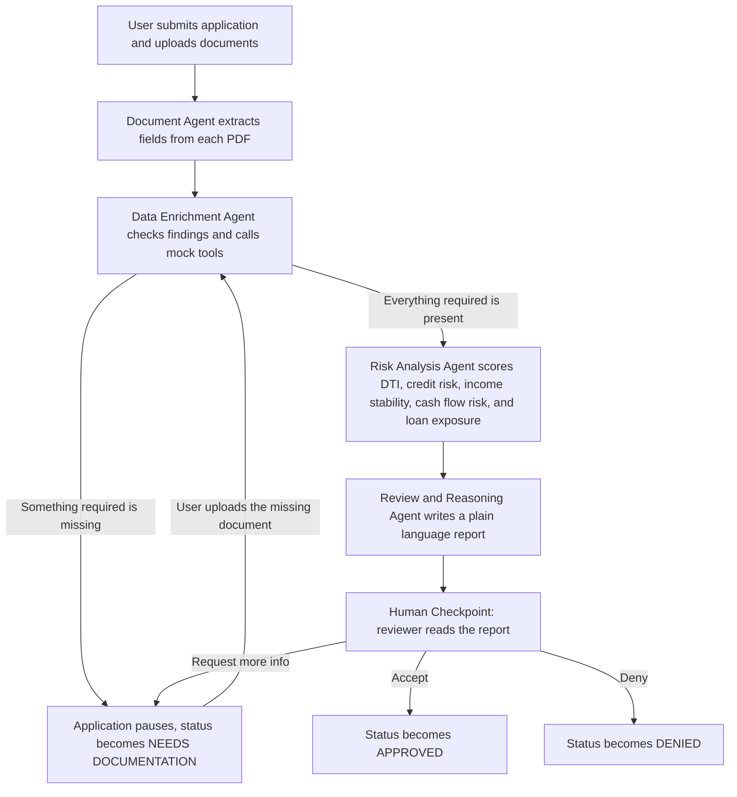
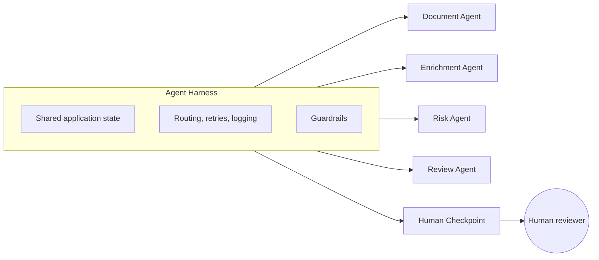

# Loan Underwriting Pipeline

[](https://github.com/vaeshnavi0718/loan-underwriting-pipeline/actions/workflows/ci.yml)

This is a small project I built to explore how a team of AI agents can work together on a real workflow, while still keeping a human in charge of the final call.

It simulates a loan underwriting process from start to finish. A person submits a loan application along with supporting documents, a set of agents read and analyze everything, and then a human reviewer makes the actual decision. The agents never get to approve or deny anything themselves.

Every piece of data in this project is made up. There are no real applicants, no real credit bureau data, and no real bank or employer connections anywhere in the code. All ten plus sample applications were generated for testing purposes only.

## Why this exists

A lot of agent demos either automate the entire decision or barely use agents at all. I wanted something in between. Agents that do real analytical work, reading documents, spotting missing information, scoring risk, and writing a report, but that never get to make the final call. That decision stays with a person on purpose.

## The core idea

This shows up everywhere in the code, so it is worth stating plainly:

> Agents do specialized tasks. The Harness controls the workflow. The human makes the final decision.

## How a request flows through the system



Everything in that diagram is coordinated by something I called the Agent Harness. It keeps track of where each application is in the process, saves progress to disk, retries steps that fail, and makes sure no agent skips ahead or touches a part of the system it should not, like the final decision.



## What each agent actually does

**Document Agent**
Reads the uploaded PDFs (pay stub, bank statement, credit report, ID document) and pulls out structured fields like income, balances, credit score, and payment history. This is plain text parsing, no LLM involved.

**Data Enrichment Agent**
Checks what was found using a few mock tools that stand in for real services, things like `verify_employment`, `analyze_bank_cashflow`, and `get_credit_details`. It figures out what is missing, flags anything like an income mismatch or an unverified ID, and tells the Harness whether the application needs to pause for more documents.

**Risk Analysis Agent**
Rule based, no LLM here either. It works out debt to income ratio, credit risk band, income stability, cash flow risk, and loan exposure relative to income, then rolls it up into an overall risk level.

**Review and Reasoning Agent**
This is the one agent that calls an LLM (Groq). It takes everything the earlier agents gathered and writes a report for the human reviewer in plain language. It points out inconsistencies, summarizes what matters, and explains the risk. It is explicitly instructed never to recommend a decision, and in testing it has caught things the rule based agents were never designed to check, like a date of birth that would make an applicant a minor.

## The guardrail that matters most

No agent, and no LLM call anywhere in this project, is allowed to set an application to Approved or Denied. That logic lives in exactly one place: the code that runs when a human clicks a button on the review screen. There is a test that checks this directly by trying to force an agent to approve an application and confirming the system blocks it.

## Tech used

Python and FastAPI for the web app, Jinja2 for the templates, Groq for the one LLM call in the whole system, and Pytest for testing. Application state is stored as plain JSON files on disk rather than a database, since this is a demo project and it keeps everything easy to inspect.

## Project layout

```
app/
  main.py                FastAPI app entry point
  harness/                orchestrator, shared state, guardrails
  agents/                 document, enrichment, risk, review agents
  tools/                  mock enrichment tools, PDF text extraction
  api/                    routes for applications and human review
  templates/              the three pages: submit, application detail, review
data/
  synthetic_applications/ sample applications for testing (all fake data)
  state/                  saved progress for each real application, one folder per application
scripts/
  generate_synthetic_data.py  builds the sample applications
tests/
  test_pipeline.py        automated tests covering the full pipeline
evals/
  run.py                  eval runner: python -m evals.run --suite <name>
  harness.py              runs one synthetic application through the pipeline
  cases/                  expected behavior for each synthetic application
  graders/                one file per grader
  results/                saved results from each run
render.yaml               deployment config for Render
```

## Running it locally

```
python3 -m venv venv
source venv/bin/activate
pip install -r requirements.txt
python scripts/generate_synthetic_data.py
cp .env.example .env   # then add your GROQ_API_KEY
uvicorn app.main:app --reload
```

Then open `http://127.0.0.1:8000` and submit an application. Sample documents to test with live in `data/synthetic_applications/`.

## Testing

```
pytest tests/test_pipeline.py -v
```

This covers a strong applicant, a missing document that pauses the pipeline and then resumes after upload, an income mismatch, an unverified ID, a thin credit file, all three human decisions, and the guardrail that stops agents from making a final call.

## Evals

Tests check the deterministic parts. Evals check the part an LLM touches: the Review Agent's report, which reads differently every run. The runner sends every synthetic application through the real pipeline, grades the output, and saves the full results to `evals/results/`.

```
python -m evals.run --suite review               # one run per application
python -m evals.run --suite review --repeats 3   # LLM output varies, so repeat
python -m evals.run --suite review --cases APP-005 APP-012
python -m evals.run --suite review --from-results evals/results/<file>.json   # re-grade saved reports, no new LLM calls
```

Checks that need to understand meaning (did the report flag the minor's date of birth?) use an LLM judge in `evals/judge.py`. It asks one yes/no question at a time about the whole report, and a "yes" must quote the report: the quote is checked in code, so the judge can't rule on text it made up. The judge runs on a different model family (`qwen/qwen3.8-27b`) from the Review Agent (`gpt-oss-120b`), since models tend to grade their own family's writing too kindly.

What each application should produce is written down in [`evals/cases/review_cases.yaml`](evals/cases/review_cases.yaml): where the pipeline should stop, the facts its report must mention, and the things it must not claim (false alarms, and misreadings seen in real runs).

| Suite | Grader | What it checks | Runs in CI |
|---|---|---|---|
| `review` | `status` (code) | The pipeline stops where expected: at the human checkpoint, or paused for exactly the missing documents | yes |
| `review` | `schema` (code) | The report has all five fields with the right types | yes |
| `review` | `grounding` (code) | Every dollar amount in the report exists in the data the agent was given | yes |
| `review` | `no_decision` (code) | The report never recommends or implies approve/deny ("should be approved", "would likely qualify", "strong candidate") | yes |

CI runs without an API key, so the Review Agent uses its fallback report there and the run costs nothing. Suites that grade the LLM's actual reasoning run locally with `GROQ_API_KEY` set. Latest results are summarized in [`evals/RESULTS.md`](evals/RESULTS.md), and the plan for the rest of the suite is in [`docs/ROADMAP.md`](docs/ROADMAP.md).

## Sample applications

There are a dozen sample applications under `data/synthetic_applications/`, each built to test a different situation:

| Application | Situation |
|---|---|
| APP 001 | A strong applicant with clean numbers across the board |
| APP 002 | High debt compared to income |
| APP 003 | Low credit score |
| APP 004 | Missing a required document on purpose, to test the pause and resume flow |
| APP 005 | Pay stub and bank deposits do not line up |
| APP 006 | ID document that comes back unverified |
| APP 007 | A borderline case that needs a closer look |
| APP 008 | Self employed applicant with uneven cash flow |
| APP 009 | Loan amount that is large relative to income |
| APP 010 | Thin credit file, no score on record yet |
| APP 011 | Unemployed applicant with no pay stub to provide |
| APP 012 | Financials look fine, but the date of birth suggests the applicant is a minor |

## Deploying

The project includes a `render.yaml` file, so it can be deployed on Render as a Blueprint. Connect the GitHub repository, let Render read the config, add your `GROQ_API_KEY` when it asks, and it will build and deploy on its own.

Keep in mind the free tier goes to sleep after a period of no traffic and takes a moment to wake back up, and the file system resets on every redeploy. That is fine for a demo, just not something to rely on for anything that needs to persist.
